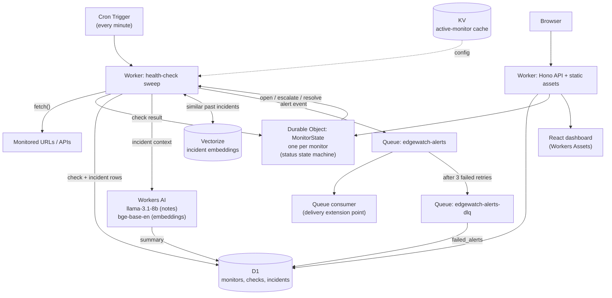

# EdgeWatch
 
**AI-powered synthetic monitoring and incident intelligence, built entirely on Cloudflare's developer platform.**

**Live demo: [edgewatch.guptaaniket600-ag.workers.dev](https://edgewatch.guptaaniket600-ag.workers.dev)** — read-only, no sign-in.
The monitors there are genuinely checked from Cloudflare's edge every minute, and the incident
notes were written by Workers AI from real check history.

EdgeWatch checks your URLs and APIs from Cloudflare's edge on a schedule, detects outages and
latency degradation, and uses Workers AI to write a human-readable incident note — cross-referenced
against similar past incidents — instead of just flipping a status dot red.

> **Why this exists:** most uptime monitors tell you *that* something broke. The interesting
> problem is telling you *what* broke, what the pattern looks like, and whether you've seen it
> before. That's the part this project is actually about.

---

## What it does

- **Edge health checks** — every monitor is checked on a cron trigger from Cloudflare's network,
  with a configurable interval, expected status code, and timeout.
- **Three-state detection** — `up` / `degraded` / `down`. A response that is *correct but slow*
  (over 50% of the configured timeout) is reported as `degraded`, so an endpoint drifting toward
  failure surfaces before it actually fails.
- **Debounced incidents** — a single failed check does not open an incident. Two consecutive
  failures do. This avoids paging on a transient blip while still reacting within ~2 minutes.
- **AI incident notes** — when an incident opens, Workers AI reads the recent check history and
  writes what failed, the observable pattern, and a likely cause. When it recovers, it writes a
  resolution note with the outage duration.
- **Similar-incident correlation** — every incident is embedded and stored in Vectorize. New
  incidents are matched against that monitor's history, so a recurring failure is identified as
  recurring rather than described in isolation.
- **Queue-based alerting** — incident events are published to a Cloudflare Queue, which owns
  batching and retries independently of the health-check sweep. An alert that still fails after
  3 retries moves to a dead-letter queue, whose consumer saves it to D1 so it isn't lost when the
  queue's 24-hour retention expires.
- **Bounded history** — a daily cron prunes raw checks older than 30 days (`CHECK_RETENTION_DAYS`)
  in capped batches, so the checks table stays a fixed size instead of growing ~1,440 rows per
  monitor per day forever. Incidents and their AI notes are kept.
- **Dashboard** — React SPA served directly from the Worker: live status, uptime, a latency
  sparkline, check history, and a filterable incident feed.

---

## Architecture



### Cloudflare services used

| Service | Role in EdgeWatch |
|---|---|
| **Workers** | HTTP API, static-asset serving, cron handler, queue consumer |
| **Cron Triggers** | Drives the once-a-minute health-check sweep and the daily retention job |
| **Durable Objects** | One instance per monitor; owns the status state machine with strong consistency |
| **D1** | Monitors, check history, incident log |
| **KV** | Hot cache of active-monitor configs for the sweep |
| **Queues** | Decouples alert delivery from the check path; owns retries and dead-lettering |
| **Workers AI** | Incident/resolution note generation + text embeddings |
| **Vectorize** | Semantic search over past incidents for correlation |
| **Workers Assets** | Serves the React dashboard from the same Worker |

### Design decisions worth calling out

**Why a Durable Object per monitor?** Deciding "has this monitor failed enough times to be an
incident?" is a read-modify-write on shared state. Done in D1 from a concurrent sweep, two
overlapping ticks could both see one failure and either double-open an incident or miss the
threshold. A Durable Object gives each monitor a single-threaded, strongly-consistent owner of
that decision, which removes the race entirely rather than papering over it with locking.

**Why does the DO not write to D1 or call AI?** The DO's job is the decision, and it should return
in milliseconds. D1 writes, AI generation, Vectorize queries, and queue sends all happen back in
the Worker afterwards, so the hot path never blocks on a slow LLM call.

**Why is the incident row written before the AI summary?** A monitoring tool that loses an incident
record because the LLM was unavailable is worse than one with no AI at all. The incident is
inserted first and the summary patched in after; generation failures fall back to a deterministic
description.

**Why a similarity floor on Vectorize?** Vectorize always returns its top-k nearest neighbours. On
a near-empty index those neighbours are unrelated, and feeding them to the model would make it
assert a recurring pattern that doesn't exist. A 0.7 cosine floor means "no similar incidents" is
a representable answer.

---

## Project layout

```
worker/                      Cloudflare Worker (API, cron, queue consumer, DO)
  src/
    index.ts                 Hono app + exported fetch/scheduled/queue handlers
    scheduled.ts             The health-check sweep
    durable-objects/
      MonitorState.ts        Durable Object (storage wrapper)
      state-machine.ts       Pure status-transition logic
    ai/
      summarize.ts           Workers AI incident/resolution notes
      similar.ts             Vectorize embedding + similarity search
      prompts.ts             Prompt construction
    lib/                     Check execution, incident persistence, retention, validation, KV cache
    routes/                  /api/monitors, /api/incidents
  migrations/                D1 schema (0001) and incremental migrations
  test/                      Vitest suite (53 tests)
dashboard/                   React + Vite SPA
```

---

## Local development

```bash
npm ci

# D1 schema into the local simulated database
npm run db:migrate:local --workspace=worker

# Dashboard must be built once -- the Worker's assets binding points at dashboard/dist
npm run build:dashboard

# Set a local API token
echo 'API_TOKEN="local-dev-token"' > worker/.dev.vars

npm run dev:worker          # http://127.0.0.1:8787
```

For dashboard development with hot reload, run `npm run dev:dashboard` alongside it — Vite proxies
`/api` to the Worker on port 8787.

> **Note on local dev:** Workers AI and Vectorize bind to *real remote resources* even under
> `wrangler dev`, so exercising the incident-summarization path locally requires a Cloudflare
> account and incurs usage charges. The test suite covers that whole pipeline with in-memory
> binding fakes instead, so `npm test` needs no account.

```bash
npm test                              # 53 tests, no Cloudflare account needed
npm run typecheck --workspace=worker
```

---

## Deploying

Each step below creates a resource and prints an id. Paste the ids into `worker/wrangler.toml`
where marked `REPLACE_AFTER_...`.

```bash
# 1. Authenticate
npx wrangler login

# 2. D1 database  -> copy database_id into wrangler.toml
npx wrangler d1 create edgewatch-db

# 3. Apply the schema to the remote database
npm run db:migrate:remote --workspace=worker
npx wrangler d1 execute edgewatch-db --remote --file=./migrations/0002_summary_source.sql
npx wrangler d1 execute edgewatch-db --remote --file=./migrations/0003_checks_retention.sql
npx wrangler d1 execute edgewatch-db --remote --file=./migrations/0004_failed_alerts.sql

# 4. KV namespace  -> copy id into wrangler.toml
npx wrangler kv namespace create CONFIG_CACHE

# 5. Queues (main + dead-letter). The explicit retention is required: wrangler defaults to 345600s,
#    which the Workers Free plan rejects as "queue settings are invalid".
npx wrangler queues create edgewatch-alerts --message-retention-period-secs 86400
npx wrangler queues create edgewatch-alerts-dlq --message-retention-period-secs 86400

# 6. Vectorize index (768 dims matches the bge-base-en-v1.5 embedding model)
npx wrangler vectorize create edgewatch-incidents --dimensions=768 --metric=cosine
npx wrangler vectorize create-metadata-index edgewatch-incidents \
  --property-name=monitorId --type=string

# 7. API token for the dashboard and API
npx wrangler secret put API_TOKEN

# 8. Build the dashboard and deploy
npm run deploy
```

Durable Objects, Workers AI, and the cron trigger need no manual provisioning — they're created
from `wrangler.toml` on deploy.

Open the deployed URL, enter the `API_TOKEN` you set, and add a monitor. The cron sweep picks it up
on the next tick.

### Public demo mode

`PUBLIC_READ_ONLY` in `wrangler.toml` controls whether the deployment can be browsed without a
token:

| Value | Behaviour |
|---|---|
| `"true"` (default) | Anyone can view monitors and incidents. Creating, editing, pausing, and deleting still require `API_TOKEN`. Use this to share a live link. |
| `"false"` | Every `/api` route requires the token. Use this for a private deployment. |

Writes are never public in either mode — creating a monitor makes the Worker issue a request to a
caller-supplied URL, so an unauthenticated write path would be an open request proxy.

### Notes

- **Every service used here runs on the Workers Free plan.** The relevant daily/monthly free
  allowances are Workers 100k requests/day, Workers AI 10k Neurons/day, Vectorize 30M queried +
  5M stored vector dimensions/month, Queues 10k operations/day, Durable Objects 100k requests/day,
  and D1 5GB storage. A handful of monitors on a one-minute interval sits far inside all of these.
- On the Free plan, Queue message retention is fixed at 24 hours (the Paid plan allows up to 14
  days). That only affects undelivered alerts, not incident history, which lives in D1.
- **Check history is kept for 30 days.** A second cron (`0 3 * * *`) deletes older rows in
  batches of 5,000, at most 50,000 per run. The cap matters on the Free plan: deleted rows count
  toward D1's 100k rows-written-per-day allowance, so a large backlog is caught up over a few
  days rather than in one run that spends the whole day's budget.
- The cron trigger runs every minute; per-monitor intervals are enforced in the sweep, so a monitor
  set to 300s is checked every five ticks rather than every tick.
- **A newly-deployed Cron Trigger takes up to 15 minutes to propagate** across Cloudflare's
  network. Until it does, monitors sit at "never checked" and a correct deployment is
  indistinguishable from a broken one. Use `POST /api/sweep` to run a cycle immediately instead of
  guessing.
- **Check the model id against `wrangler ai models` if you change it.** `env.AI.run()` throws on an
  unknown id, which the summarizer catches and degrades from, so a typo surfaces only as "every
  note is a fallback" — see `summary_is_fallback` on the incidents table and the note label in the
  dashboard.

---

## API

Mutating routes always require `Authorization: Bearer <API_TOKEN>`. `GET` routes also require it
unless `PUBLIC_READ_ONLY` is enabled (see [Public demo mode](#public-demo-mode)).

| Method | Path | Description |
|---|---|---|
| `GET` | `/api/health` | Unauthenticated liveness check |
| `GET` | `/api/config` | Unauthenticated; tells the dashboard whether reads are public |
| `GET` | `/api/monitors` | List monitors with live Durable Object status |
| `POST` | `/api/monitors` | Create a monitor |
| `GET` | `/api/monitors/:id` | Monitor detail with check history and incidents |
| `PUT` | `/api/monitors/:id` | Update a monitor (including `is_active` to pause) |
| `DELETE` | `/api/monitors/:id` | Delete a monitor and reset its Durable Object |
| `GET` | `/api/incidents?status=open\|resolved` | Incident feed with AI notes |
| `GET` | `/api/alerts/failed` | Alerts that exhausted their retries and were dead-lettered |
| `POST` | `/api/sweep` | Run a health-check cycle immediately (what cron does) |

```bash
curl -X POST https://<your-worker>/api/monitors \
  -H "Authorization: Bearer $API_TOKEN" \
  -H "Content-Type: application/json" \
  -d '{"name":"Checkout API","url":"https://api.example.com/health","interval_seconds":60}'
```

---

## Extending alert delivery

The queue consumer logs a structured payload rather than shipping a vendor integration.
`deliver()` in `worker/src/queue/alerts.ts` is the single extension point — implement an outgoing
webhook, Slack, or email there and the Queue's existing batching, retry, and dead-letter behaviour
applies unchanged. Because today's `deliver()` only logs, it can't fail, so nothing reaches the
dead-letter queue until a real transport is added. The path is in place and tested for when one is.
